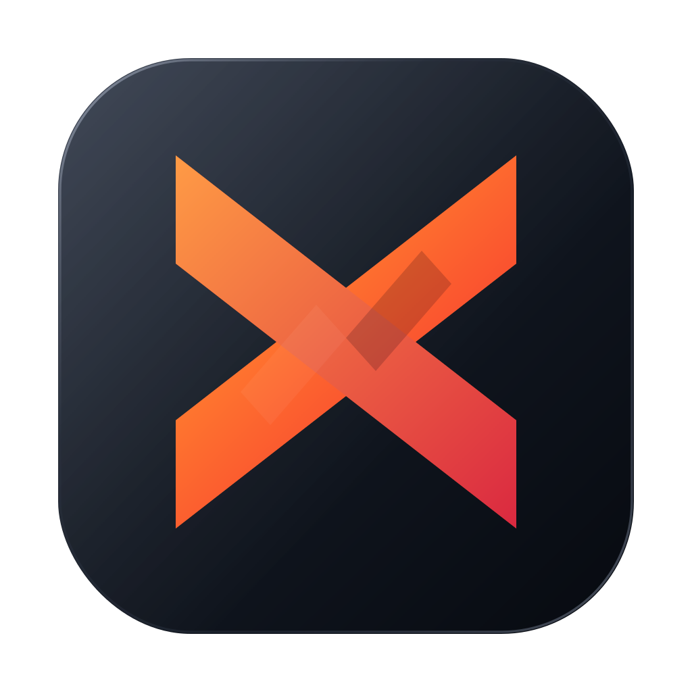

<div align="center">



# XMP Launcher

**لانچر سبک و سریع برای MTA: San Andreas — سن آندرس، بدون مرز.**

سرورها را ببین، با یک کلیک وصل شو. بدون دردسر.

[](../../releases)


</div>

---

## دانلود و نصب

1. فایل **`XMP-Launcher-Setup-1.0.0.exe`** را از بخش **Releases** دانلود کنید.
2. اجراش کنید و مراحل نصب را جلو بروید (نصب برای کاربر فعلی انجام می‌شود، نیازی به دسترسی ادمین نیست).
3. XMP را باز کنید — اگر MTA روی سیستم نصب باشد، خودش پیداش می‌کند.

> **نکته:** چون فایل نصب فعلاً امضای دیجیتال (Code Signing) ندارد، ویندوز ممکن است هشدار SmartScreen نشان بدهد. روی **More info** و بعد **Run anyway** بزنید.

**نیازمندی‌ها:** ویندوز ۱۰ یا ۱۱ (۶۴ بیت) + بازی MTA: San Andreas نصب‌شده.

## قابلیت‌ها

- **لیست زنده‌ی سرورها** از مسترلیست رسمی MTA + پینگ واقعی (ASE/UDP) برای تک‌تک سرورها
- **اتصال با یک کلیک** — با نیک‌نیم، رمز سرور و آرگومان‌های درست بازی را اجرا می‌کند
- **پیدا کردن خودکار مسیر MTA** (مسیرهای پیش‌فرض + رجیستری ویندوز) و انتخاب دستی مسیر
- **علاقه‌مندی‌ها** و بخش «ادامه بده» برای برگشت سریع به آخرین سرور
- **جستجوی سریع** با `Ctrl+K`، فیلترهای «همه / جای خالی / بدون رمز / علاقه‌مندی‌ها»
- **پروفایل بازیکن** — نیک‌نیم از تنظیمات خود MTA خوانده می‌شود و قابل ویرایش است
- **۴ تم رنگی** و حالت **سیستم ضعیف** (حذف افکت‌های سنگین گرافیکی برای PCهای قدیمی)
- **چک آپدیت** از ریلیزهای گیت‌هاب و اعلان نسخه‌ی جدید
- رابط **فارسی و راست‌چین** با فونت وزیرمتن

## مصرف منابع

XMP از اول برای سیستم‌های ضعیف طراحی شده:

| مورد | مقدار تقریبی |
|---|---|
| حجم فایل نصب | ~۷۲ مگابایت |
| RAM در حالت آماده‌به‌کار | ~۹۰ تا ۱۳۰ مگابایت |
| CPU در حالت idle | نزدیک صفر (تایمرها throttled) |

حالت «سیستم ضعیف» در تنظیمات، بلور و انیمیشن‌ها را حذف می‌کند و مصرف را باز هم پایین می‌آورد. موقع اجرای بازی هم می‌توانید لانچر را طوری تنظیم کنید که خودش بسته شود.

## مسیر نسخه مستقل (در حال طراحی)

XMP در مسیر تبدیل شدن به یک پلتفرم مستقل است: **فورک mtasa-blue با برند XMP** که اول با سرورهای فعلی MTA سازگار می‌ماند و بعد سرورهای XMP به آن اضافه می‌شوند. فایل‌های GTA San Andreas را خود کاربر تأمین می‌کند و توزیع نمی‌شود.

- معماری: [`docs/ARCHITECTURE.md`](docs/ARCHITECTURE.md)
- نقشه راه فازها: [`docs/ROADMAP.md`](docs/ROADMAP.md)

نسخه فعلی لانچر (اتصال از طریق MTA نصب‌شده) تا آماده شدن XMP Client به‌عنوان نسخه پایدار می‌ماند.

## ساخت از سورس

```bash
git clone <آدرس-ریپوی-شما>/xmp-launcher.git
cd xmp-launcher
npm install
npm start          # اجرای نسخه‌ی توسعه
npm run dist       # ساخت فایل نصب ویندوز در پوشه‌ی dist
```

ساخت فایل نصب روی لینوکس هم ممکن است (با Wine و NSIS):

```bash
npm run dist -- --win nsis
```

## انتشار نسخه‌ی جدید (GitHub)

روی هر تگ `v*`، اکشن `.github/workflows/release.yml` به‌صورت خودکار روی ویندوز بیلد می‌گیرد و فایل نصب را به ریلیز گیت‌هاب وصل می‌کند:

```bash
git tag v1.0.1
git push origin v1.0.1
```

## ساختار پروژه

```
electron/          پروسس اصلی (پنجره، IPC، شبکه، اجرا)
  main.js          پنجره‌ی بدون قاب، تک‌نمونه، میانبرها
  ase.js           پروتکل ASE روی UDP — پینگ و اطلاعات زنده‌ی سرور
  installer.js     پیدا کردن MTA و ساخت آرگومان‌های اجرا
  config.js        نرمال‌سازی داده‌ی سرور و واکشی مسترلیست
  store.js         ذخیره‌سازی تنظیمات (JSON اتمیک)
src/               رندرر (بدون فریم‌ورک — وانیلا، سریع)
  index.html       پوسته‌ی برنامه
  app.js           منطق رابط کاربری
  styles/          سیستم دیزاین
  data/demo.js     اسنپ‌شات آفلاین سرورها (فالبک اجرای اول)
assets/branding/   لوگو و هویت بصری (SVG + آیکون)
```

معماری طوری چیده شده که لایه‌ی رندرر بدون تغییر بماند و در آینده پوسته‌ی Electron با **Tauri** جایگزین شود (تمام ارتباط رندرر فقط از طریق `window.xmp` در `preload.js` است).

## ساخت اسنپ‌شات سرورها

```bash
node scripts/snapshot-servers.mjs   # بروزرسانی src/data/demo.js از مسترلیست
```

## لایسنس و سلب مسئولیت

MIT — متن کامل در `build/LICENSE.txt`.

XMP یک پروژه‌ی مستقل و متن‌باز است و وابستگی رسمی به تیم Multi Theft Auto یا Rockstar ندارد.
MTA: San Andreas خودش را از [multitheftauto.com](https://multitheftauto.com) بگیرید.
